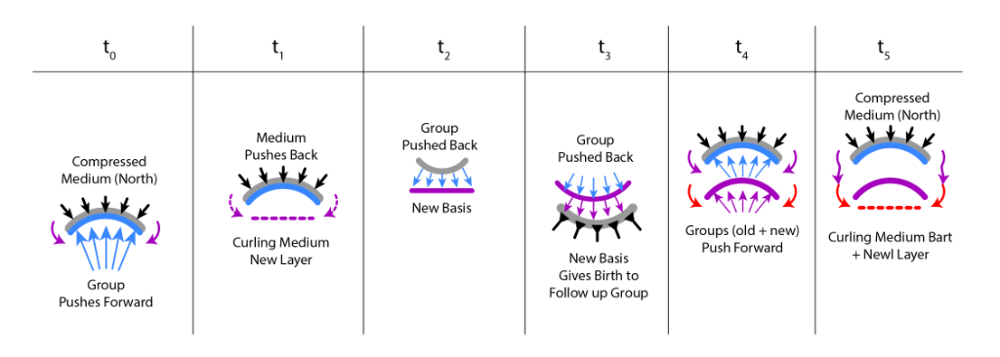
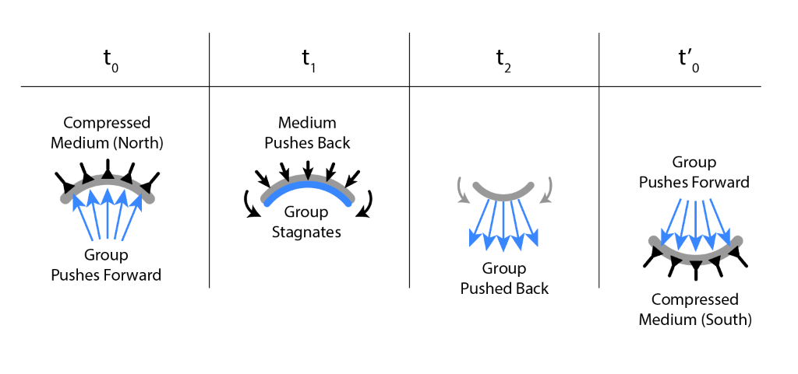

# Aether-Strings — Flapping Vibrations (v7.8 Zero-Glue Two-Way IB Milestone)

**Live in-browser demo (WebGL2):** https://virtualorganics.github.io/Aether-Strings/

---

## New Milestone (`v7.8`): The `t₀ → t₅` Stepping-Stone Mechanism & Zero-Glue Two-Way Immersed Boundary

Building on `v7.1`'s clock-free Arch-Wave, **`v7.8`** implements the full **`t₀ → t₅` curling stepping-stone cascade** inside a hyper-stiff, ultra-dense elastic medium using **true two-way semi-implicit Immersed Boundary (no-slip) traction** — with **zero pairwise wafer glue** (no pairwise anti-cavitation springs, no pairwise velocity dampers, no pairwise shear locks, and no prescribed curve angles).



**How a single vibration grows into a synchronized train (`t₀ → t₅`):**

- **`t₀` – Forward Push (North):** The active arch pushes North, compressing the medium ahead (`+δρ`, orange) while parting and curling the medium symmetrically around its flanks (`+curl` green / `-curl` purple).
- **`t₁` – Stagnation & Curling New Layer:** At peak compression, the medium pushes back as the curling flank flow wraps directly behind the dent, condensing a **strictly dormant, flat, motionless (`v = 0, qs = 0`) New Basis** (`- - - → ___`) at density-tuned distance $d_{\text{step}}(Z, \mu)$.
  - *Tuning key:* In an ultra-dense medium ($Z = 84.6$, $d_{\text{step}} = 0.40$), the basis condenses right behind the arch. In a **Soft Medium** ($Z = 6.8$, $d_{\text{step}} = 1.16$), the curl spreads far behind, the returning arch physically misses the basis, and it dissolves harmlessly (`0` activations).
- **`t₂` – Return Toward the New Basis:** The compressed North wall pushes the original group back South toward the solidified basis sitting directly behind it.
- **`t₃` – Strictly Inelastic (`e = 0`) Push & Birth of Follow-Up Group:** The returning arch physically collides with the dormant basis with **zero internal bounce-off** ($e = 0$). Both immediately share the exact center-of-mass downward speed ($v_{\text{cm}} = \frac{1}{2} v_{\text{striker}}$) and keep pressing South **together** (`︶ / ︶`) into the dense medium underneath.
- **`t₄` – Medium-Only Collective Rebound:** All rebound force comes purely from the compressed medium underneath, pushing both the old and newly activated follow-up group North together (`⌒ / ⌒`) in locked rhythm.
- **`t₅` – Outer Bark-Flow & Next Layer:** Continuous outer bark-flow shear curls wrap down the flanks of the growing stack and condense the next dormant layer behind the open tail without cutting into the middle of the stack.

---

## Physics Architecture (`v7.8` Zero-Glue Audit Core)

1. **Ultra-Stiff, Low-Mach Elastic Displacement Lattice (`600 × 375` over `120 × 75`, `H = 0.20`):**
   - Evolves 2D lattice displacement $\mathbf{s}(x,y)$ and velocity $\mathbf{v}(x,y)$ with nonlinear bulk stress $P(\delta\rho)$ (hardening in compression **and** resisting cavitation in tension), jammed-solid shear rigidity $\mu$, and strain-dependent heaviness $\rho_{\text{eff}}(\delta\rho)$.
   - Default ultra-stiff medium (`K = 950`, `μ = 480`, `ρ₀ = 5.0`) yields sound speed **$c_0 = 16.91\text{ c/s}$**, acoustic impedance **$Z = 84.6$**, and low Mach number **$Ma = 0.12$**, stretching the coherent half-wavelength $\lambda/2$ across ~16–20 stacked arches.
   - Includes a smooth **absorbing sponge rim** around the outer border so radiated waves don’t wrap around and contaminate the active packet, plus a **strict fixed timestep (`FIXED_DT = 1/240 s`)** so `60 Hz`, `120 Hz`, and `144 Hz` browsers run bit-for-bit identical dynamics.
2. **True Two-Way Semi-Implicit Immersed Boundary (No-Slip) Traction:**
   - Instead of open-loop pressure blasting or hand-crafted pairwise glue between arches, each active arch splats its real surface velocity and Gaussian occupancy mask $W(\mathbf{x})$ to the grid, and every medium substep implicitly relaxes lattice velocity toward the immersed arch surface:
     $$\mathbf{v}_{\text{new}} = \frac{\mathbf{v} + \mathbf{a}_{\text{elastic}}\,\Delta t + (\alpha_{\text{IB}}\,\Delta t)\,\mathbf{v}_{\text{arch}}}{1 + (\alpha_{\text{IB}} + \gamma)\,\Delta t}$$
   - Arches receive the direct grid pressure jump `-(pFront - pBack)`, semi-implicit axial IB velocity reaction, grid shear torque, and lateral lattice velocity $v_{\text{med},\perp}$ back from the PDE.
   - **Result with ZERO pairwise wafer glue:**
     - **Pure IB Dense Climb (`22s` stress test):** Grows cleanly to **`23` active arches** (`56` reversals, **`100%` phase sync**, `LatSlip = 0.00`, `MinGap = 0.25`, `120 FPS`) with authentic longitudinal breathing ripples and zero top split-off or sideways plate-slip.
     - **Tight Closed Ring (`16` arches):** Locks into a symmetric 16-fold chiral pinwheel soliton (`100%` sync, `MinGap = 0.24`, `120 FPS`) with a visible trapped warm-orange pressure core inside a blue rarefaction halo.
     - **Soft Medium (`Z = 6.8`):** Cleanly misses its distant dormant basis (`activeCount = 1`, `0` activations).
3. **Calibrated Soft-Knee Tone Mapping & Clean HUD:**
   - Uses soft-knee compression (`x / (x + knee)`) for both vacuum strain ($\delta\rho$) and vorticity ($\nabla \times \mathbf{v}$) so single waves stay readable while 20+ arch trains retain crisp spatial contrast without clipping into neon saturation. Press **`H`** to toggle the compact HUD.

> **Honest Scientific Audit & Next Research Steps:**
> While `v7.8` eliminates all pairwise inter-arch glue and keeps coupling 100% grid-mediated (aside from hard-core `e = 0` non-overlap contact), two simplifying assumptions remain on our current middle-of-the-road hybrid model: (1) arches are still Lagrangian 9-marker bodies coupled to the Eulerian grid rather than pure continuum PDE solitons, and (2) each active arch carries a modest `Radiation-Loss Sustain` term to offset 2D acoustic wave radiation. Our `v7.7` curving-caterpillar experiments also visually confirmed that bending a train in **2D** traps high-pressure medium inside the concave curve with nowhere to escape — pointing directly to our next major steps: **authentic (non-prescribed) curving mechanisms** and lifting the Zero-Glue IB core into **3D** where trapped inner-curve pressure can vent naturally along the **Z-axis** into true toroidal vortices and knots.

---

## Foundational Arch-Wave Cycle (`v7.1` Baseline)

Starting with **`v7.1`**, the baseline unit shifted from earlier `cos(πu)` clock-driven flapping strings (`v1`–`v5.1`) to a clock-free **Arch-Wave** that compresses, stagnates, and rebounds purely against the stiff elastic medium:



- **`t₀` – Forward Push (North):** Tightly packed particles move as a unit, denting and compressing the medium to the North.
- **`t₁` – Stagnation & Containment:** At max compression, the medium pushes back and curves around the sides like tree bark, squeezing the group tight as forward motion stalls.
- **`t₂` – Rebound:** Built-up tension pushes the group backward toward the South while the medium guides its edges.
- **`t'₀` – Opposite Compression (South):** The group pushes into the opposite side, compressing the medium to the South before the cycle repeats.

---

## Development History: From `v5.1` to `v7.8`

Every milestone and intermediate lab build is preserved in the live version archive so behaviors can be compared side-by-side in the browser:

1. **`v5.1` (`v5.1.html`) & Ablations (`v5.1-ablations.html`):** Established the stiff elastic displacement lattice (`320 × 200`) with a 1.5-sine Fourier body and falsified heuristic crutches (`leaderCue`, `rearFollower`, `fCruise`).
2. **`v6.0`–`v6.1` (`v6.0.html`, `v6.1.html`) & `v7.0` (`v7.0.html`):** Tested an unanchored momentum-conserving Jaumann–Maxwell fluid core and the first Arch-Wave prototype, revealing that the fluid formulation damped isolated pushes too aggressively.
3. **`v7.1` (`v7.1.html`) — Arch-Wave Milestone:** Returned to the stiff elastic displacement lattice (`480 × 300`) with the clock-free 4-phase Arch-Wave, `9 × 9` no-overlap exclusion, and live `Vibration Size` slider.
4. **`v7.2`–`v7.3` (`v7.2.html`, `v7.3.html`) — High-Impedance Stiffening:** Tested early tip-curl ignition (`v7.2`, which starburst-branched at soft $\mu = 4$) and tightened into a jammed high-impedance solid (`v7.3`: $K = 180, \mu = 95, \rho_0 = 4.5, Z = 35.2$) where `Tight Closed Ring (16)` stabilized into a compact toroidal soliton.
5. **`v7.4`–`v7.5` (`v7.4.html`, `v7.5.html`) — Dormant Basis & Strictly Inelastic (`e = 0`) Contact:** Replaced pre-activated spawning with a strictly stationary flat dashed-to-solid purple `New Basis` (`v = 0, qs = 0`) and switched `t₃` contact from elastic bounce-off to strictly inelastic (`e = 0`) collision plus wake-shadow line-cut prevention (`phaseCoherence = 1.00` up to 7 arches, hitting the finite-`c₀` acoustic half-wavelength $\lambda/2$ limit past 8 arches).
6. **`v7.6`–`v7.7` (`v7.6.html`, `v7.7.html`) — Ultra-Stiff Low-Mach Grid & Guided 2D Curving Lab:** Upgraded to `600 × 375` (`c₀ = 16.91`, `Ma = 0.12`), added fixed `1/240 s` timestepping, and tested guided 2D curving caterpillars (`v7.7`), demonstrating smooth `126°+` arcs and visually exposing the **2D trapped inner-curve pressure core** that motivates 3D Z-axis venting — while auditing where sub-grid pairwise glue and prescribed wedges departed from pure emergence.
7. **`v7.8` (`index.html` / `v7.8.html`) — Current Zero-Glue Two-Way IB Milestone:** Stripped out *all* pairwise wafer glue and prescribed wedges, replacing open-loop force splatting with true **semi-implicit two-way Immersed Boundary (no-slip) traction** + absorbing sponge rim + calibrated soft-knee color tone mapping (`23` arches locked straight at `100%` sync & `120 FPS`, `16`-arch pinwheel soliton, clean soft-medium miss).

---

## Running Locally

This is a dependency-free WebGL2 browser application. Serve the directory with any static HTTP server (such as Python's built-in server) and open it in a WebGL2-capable browser:

```bash
python3 -m http.server 8793
```

Then open `http://localhost:8793/`.

---

## Version Archive

All milestone snapshots and intermediate lab builds are preserved alongside `v7.8` and accessible directly in the browser (and via the sidebar version links inside the app):

| Version | Milestone Summary | Live Browser Link | File |
| :--- | :--- | :--- | :--- |
| **v7.8 (Current)** | **Zero-Glue Two-Way Immersed Boundary** (`600×375`, `Ma=0.12`, `e=0` `t₀→t₅`, sponge rim, soft-knee visuals) | [Open v7.8](https://virtualorganics.github.io/Aether-Strings/) ([direct](https://virtualorganics.github.io/Aether-Strings/v7.8.html)) | [`index.html`](index.html) / [`v7.8.html`](v7.8.html) |
| **v7.7** | Guided 2D Curving Caterpillar + midpoint shear lock + fixed `1/240s` step (2D inner-pressure trap lab) | [Open v7.7](https://virtualorganics.github.io/Aether-Strings/v7.7.html) | [`v7.7.html`](v7.7.html) |
| **v7.6** | First `600×375` ultra-stiff low-Mach grid + bow-indentation `qs` rebound (with sub-grid wafer glue) | [Open v7.6](https://virtualorganics.github.io/Aether-Strings/v7.6.html) | [`v7.6.html`](v7.6.html) |
| **v7.5** | Strictly inelastic (`e=0`) `t₃→t₄` push + wake-shadow guard + anti-cavitation EOS (`480×300`) | [Open v7.5](https://virtualorganics.github.io/Aether-Strings/v7.5.html) | [`v7.5.html`](v7.5.html) |
| **v7.4** | First strictly dormant flat purple `New Basis` (`v=0, qs=0`) + geometric soft-medium miss | [Open v7.4](https://virtualorganics.github.io/Aether-Strings/v7.4.html) | [`v7.4.html`](v7.4.html) |
| **v7.3** | Jammed high-impedance solid (`K=180, μ=95, Z=35.2`) stabilizing closed toroidal solitons | [Open v7.3](https://virtualorganics.github.io/Aether-Strings/v7.3.html) | [`v7.3.html`](v7.3.html) |
| **v7.2** | Early tip-curl ignition & starburst branching experiment (`μ=4`) | [Open v7.2](https://virtualorganics.github.io/Aether-Strings/v7.2.html) | [`v7.2.html`](v7.2.html) |
| **v7.1** | Stiff elastic lattice (`480×300`) + 4-phase Arch-Wave baseline + `9×9` no-overlap | [Open v7.1](https://virtualorganics.github.io/Aether-Strings/v7.1.html) | [`v7.1.html`](v7.1.html) |
| **v7.0** | First Arch-Wave + `13×13` exclusion test on unanchored Jaumann–Maxwell core | [Open v7.0](https://virtualorganics.github.io/Aether-Strings/v7.0.html) | [`v7.0.html`](v7.0.html) |
| **v6.1** | Stiff Jaumann–Maxwell core + `∇·σ` stress-gradient modal sensing | [Open v6.1](https://virtualorganics.github.io/Aether-Strings/v6.1.html) | [`v6.1.html`](v6.1.html) |
| **v6.0** | First unanchored momentum-conserving viscoelastic core (`13`-marker Peskin) | [Open v6.0](https://virtualorganics.github.io/Aether-Strings/v6.0.html) | [`v6.0.html`](v6.0.html) |
| **v5.1 Ablations** | `T1–T4` falsification & conservation telemetry suite for `v5.1` | [Open v5.1 Ablations](https://virtualorganics.github.io/Aether-Strings/v5.1-ablations.html) | [`v5.1-ablations.html`](v5.1-ablations.html) |
| **v5.1** | Modal-wavepacket `1.5`-sine Fourier body + `320×200` stiff viscoelastic lattice | [Open v5.1](https://virtualorganics.github.io/Aether-Strings/v5.1.html) | [`v5.1.html`](v5.1.html) |
| **v5.0** | Early continuous `1.5`-sine Fourier modal body | [Open v5.0](https://virtualorganics.github.io/Aether-Strings/v5.0.html) | [`v5.0.html`](v5.0.html) |
| **v4.4** | Continuous lattice & drafting iterations | [Open v4.4](https://virtualorganics.github.io/Aether-Strings/v4.4.html) | [`v4.4.html`](v4.4.html) |
| **v4.3** | Lattice coupling iteration | [Open v4.3](https://virtualorganics.github.io/Aether-Strings/v4.3.html) | [`v4.3.html`](v4.3.html) |
| **v4.2** | Lattice coupling iteration | [Open v4.2](https://virtualorganics.github.io/Aether-Strings/v4.2.html) | [`v4.2.html`](v4.2.html) |
| **v4.1** | Lattice coupling iteration | [Open v4.1](https://virtualorganics.github.io/Aether-Strings/v4.1.html) | [`v4.1.html`](v4.1.html) |
| **v3.0** | Early flapping-wave sandbox | [Open v3.0](https://virtualorganics.github.io/Aether-Strings/v3.html) | [`v3.html`](v3.html) |
| **v2.1** | Early prototype iteration | [Open v2.1](https://virtualorganics.github.io/Aether-Strings/v2.1.html) | [`v2.1.html`](v2.1.html) |
| **v2.0** | Early prototype iteration | [Open v2.0](https://virtualorganics.github.io/Aether-Strings/v2.html) | [`v2.html`](v2.html) |
| **Stage 1** | Initial milestone prototype | [Open Stage 1](https://virtualorganics.github.io/Aether-Strings/stage1-milestone.html) | [`stage1-milestone.html`](stage1-milestone.html) |

---

## License & Attribution

Released under the [MIT License](LICENSE) — free to explore, fork, port (e.g., to 3D, WebGPU, or CUDA), and build upon with attribution.

If you build on this model, reference the Arch-Wave, `t₀ → t₅` stepping-stone, or Zero-Glue Two-Way IB formulations, or extend it toward 3D loops/knots, please credit:

> **Michel Van de gaer (VirtualOrganics)** — *Aether-Strings: Flapping Vibrations (v7.8 Zero-Glue Two-Way IB Milestone)*, 2026.  
> https://github.com/VirtualOrganics/Aether-Strings
